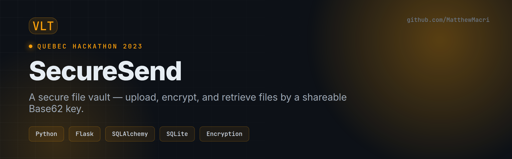
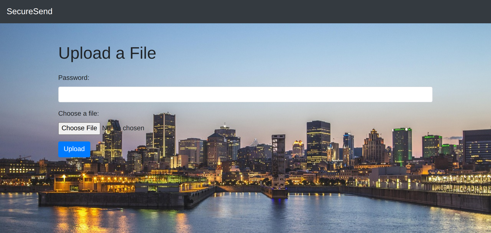
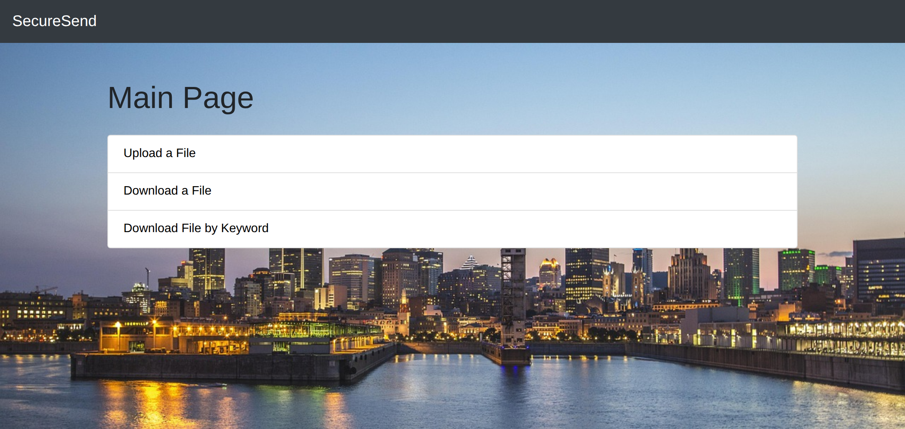

# SecureSend — Secure File Vault

> Upload a file, encrypt it at rest, and retrieve it later with a short, shareable Base62 key. Built in a weekend for the 2023 Quebec Hackathon.


---

## Overview

**SecureSend** is a Flask web app for storing and sharing files securely. When you upload a file it is **encrypted** before being written to the database, and you get back a compact **Base62 key** that acts as the retrieval handle. Anyone with the key (and password) can download and decrypt the file — anyone without it just sees ciphertext.

My team built this during the **2023 Quebec Hackathon**.

## Preview

| Upload | Browse / Download |
|---|---|
|  |  |

## Features

- 🔐 **Encrypt on upload** — file bytes are encrypted before storage
- 🔑 **Base62 keys** — short, URL-friendly identifiers for each file
- ⬆️ **Upload** with a password and file-type allow-list
- ⬇️ **Download** by key, with decryption on retrieval
- 🔎 **Download by keyword** — look files up by name
- 🗄️ **SQLAlchemy models** over an SQLite datastore
- 🧩 **REST + rendered UI** — a JSON API (`app.py`) and a server-rendered interface (`main.py`)

## Tech Stack

| Area | Tools |
|------|-------|
| Backend | Python, Flask |
| ORM / DB | SQLAlchemy, SQLite |
| Templating | Jinja2 + Bootstrap |
| Security | File encryption, Base62 encoding, password check |

## Getting Started

```bash
git clone https://github.com/MatthewMacri/QuebecHackathon2023.git
cd QuebecHackathon2023/PythonUploader-master

python3 -m venv venv && source venv/bin/activate
pip install flask sqlalchemy

# Rendered web UI (upload / download pages)
python3 main.py          # http://localhost:5000

# — or — the JSON API
python3 app.py           # http://localhost:5001
```

## Project Structure

```
PythonUploader-master/
├── main.py          # Flask app with the rendered UI  ← start here
├── app.py           # JSON REST API variant
├── models.py        # SQLAlchemy File model + session
├── utils.py         # allow-list, unique IDs, Base62 encode
├── bcryptmodule.py  # encrypt / decrypt helpers
├── config.py        # DB URI, Base62 alphabet, allowed extensions
└── templates/       # upload, download, results pages
```

## Notes

This was a hackathon build, so the crypto here is a learning exercise rather than a production-grade scheme — treat it as a demo of the architecture (encrypt-at-rest + key-based retrieval), not a vault for real secrets.

## Author

**Matthew Macri** (team project) — [LinkedIn](https://www.linkedin.com/in/m-macri/) · [GitHub](https://github.com/MatthewMacri)
